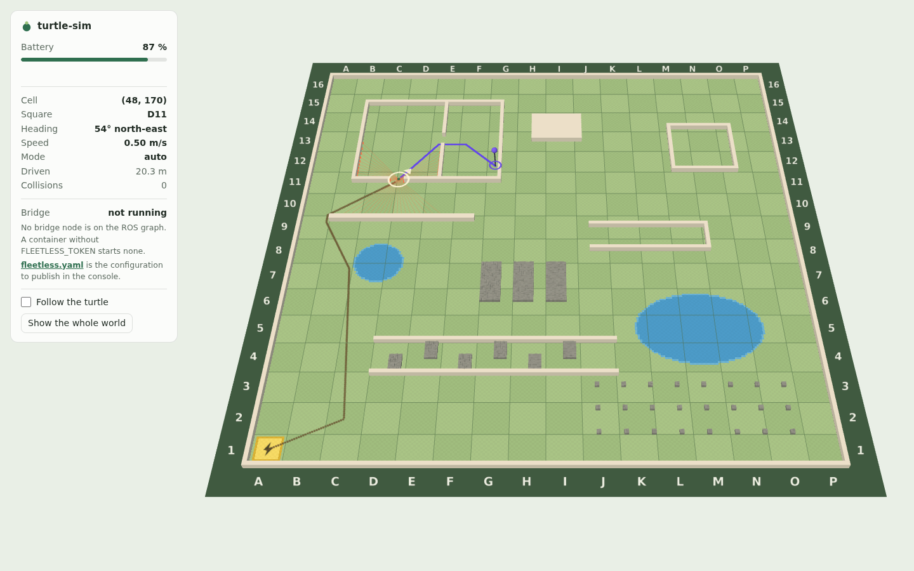
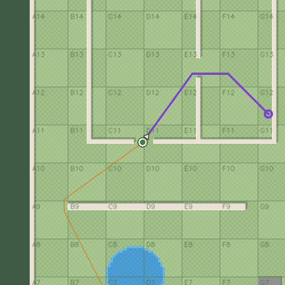
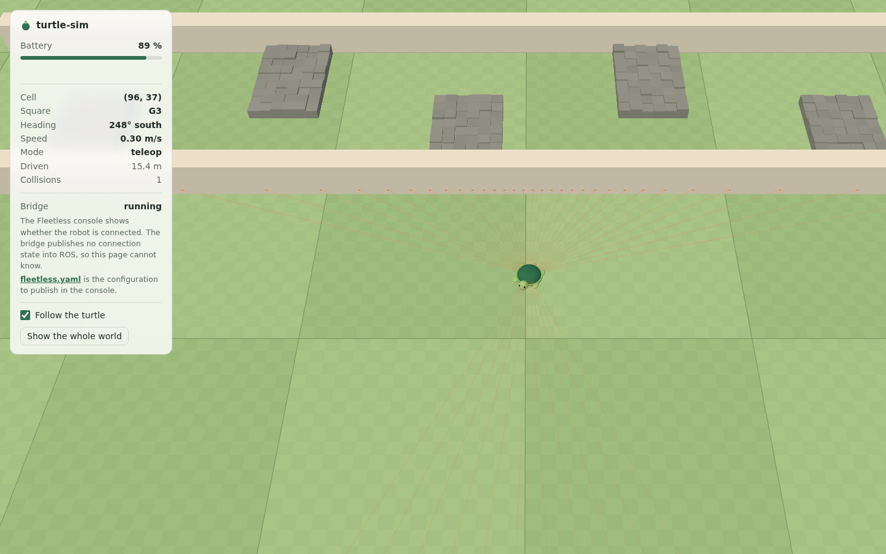
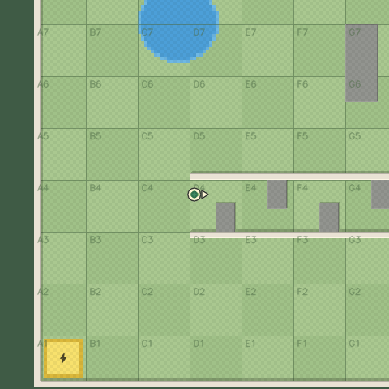
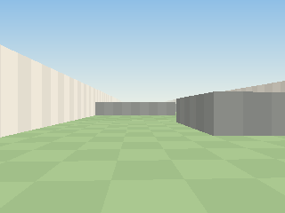
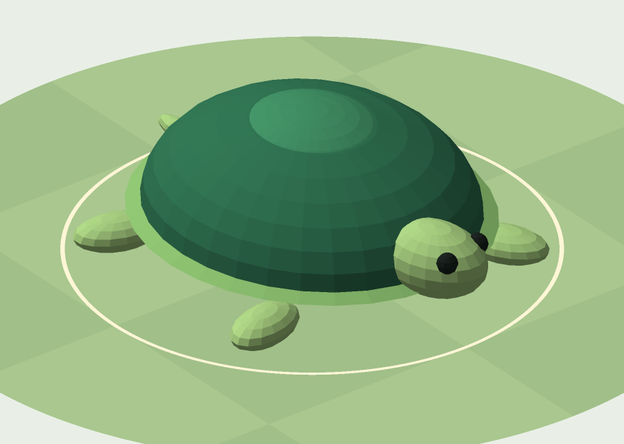
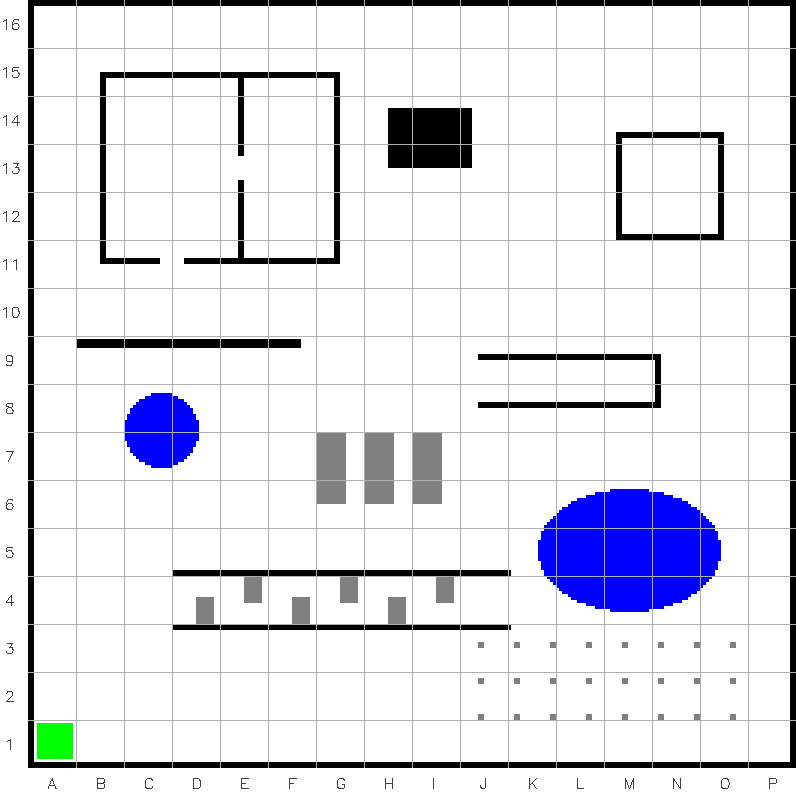

# 🐢 turtle-sim

A turtle on two wheels in a garden of 256 × 256 cells, with ROS 2 Jazzy and
the Fleetless Bridge, in one Docker image. One line starts it, and it
connects to [Fleetless](https://fleetless.dev) exactly as a real robot does:
live values, alerts, a publisher to drive it with, services, actions that
send it across the garden by itself, two cameras and a model that walks.
It needs no GPU, no X11 and no robot.


## 🚀 Three steps

> The image is private for now. Run `docker login ghcr.io` first, with a
> token that may read the packages of the `fleetless` organisation.

**1. Create the robot.** In the [console](https://console.fleetless.dev), open
**Robots** and create one. The token (`frt_…`) is shown once. Copy it.

**2. Start the turtle.** One line, the same in bash, PowerShell and cmd:

```sh
docker run --rm -it --name turtle -p 127.0.0.1:8765:8765 -v turtle-state:/state -e FLEETLESS_TOKEN=frt_... ghcr.io/fleetless/turtle-sim
```

The view is at <http://localhost:8765>, and the robot turns connected in the
console within a few seconds. To keep the token out of the shell history,
put `FLEETLESS_TOKEN=frt_...` into a file and pass that:

```sh
docker run --rm -it --name turtle -p 127.0.0.1:8765:8765 -v turtle-state:/state --env-file turtle.env ghcr.io/fleetless/turtle-sim
```

Or the same container by Docker Compose. Take
[`docker-compose.yaml`](docker-compose.yaml) and [`.env.example`](.env.example)
from this repository, copy `.env.example` to `.env`, write the token into
it, and start it beside the two files:

```sh
docker compose up
```

Ctrl-C stops the turtle and `docker compose down` removes it. `.env` is in
`.gitignore`, so the token stays out of every commit. Any Docker Compose v2
will do; Docker Desktop brings one.

Compose keeps the turtle's state in a volume of its own, apart from the one
line's `turtle-state`, so switching between the two leaves nothing behind but
the bridge's record of jobs in flight.

Without a token the simulator and the view run all the same; no bridge is
started, and the log says so.

**3. Publish the configuration.** The robot exposes nothing until it is told
what. Take [`fleetless/turtle.fleetless.yaml`](fleetless/turtle.fleetless.yaml),
which the view also hands out at <http://localhost:8765/fleetless.yaml>, put
it into the robot's configuration in the console and publish it.

Publishing lists one `unknown_type` warning per entry, for standard ROS types
as much as for the turtle's own: the cloud has not looked at this robot's
message types yet. They are warnings. The file publishes, the bridge applies
it, the values flow. To be rid of them, have the cloud fetch the types once
while the turtle is connected (over MCP: `console_introspection_write`,
action `fetch_types`) and publish again.

## 🕹️ What to try

- **Drive it.** The console's Controls send `drive`: a speed and a turn
  rate. Watch `square` change. When the messages stop, the turtle stops by
  itself, half a second later.
- **Send it somewhere.** `drive_to_square` with `square: H9` is a job. The
  turtle plans a path round the pond and the rocks, says twice a second how
  far it has left, and the job ends `reached`. `M5` is all pond:
  `target_occupied`. `N13` is a courtyard without a door: `unreachable`.
  Cancel a job on the way and the turtle brakes and stands within two
  seconds. Touch the Controls instead and the job ends `teleop_override`: a
  person at the controls wins.
- **Get in its way.** `set_block` puts a rock on a cell. Put one on its path
  and it stops, plans again and goes round. `set_trail` with `record: true`
  shows where it has been. `reset` clears up after you.

| the view | `top`, at the same moment |
|---|---|
|  |  |

- **Ask a model.** Connect an MCP client to Fleetless and ask what the robot
  exposes (`robots.describe`), then to take the turtle to the pond, as close
  as it gets, and back to the pad to charge. The descriptions in the yaml
  are all the model has to go on, which is why they are long.
- **Build on it.** The [app starter](https://docs.fleetless.dev/recipes/app-starter/)
  is a dashboard on `@fleetless/sdk`. Point it at this robot.
- **Look through its eyes.** The robot's **Cameras** show `top`, the map
  around the turtle, and `eye`, what it sees from 0.1 m above the lawn.
  [The first `top`](docs/camera-top-start.png) is two thirds dark green:
  the pad lies in the garden's corner, and past the wall there is
  nothing. Over MCP a snapshot of either is a picture, so whatever you
  asked to drive can also look where it is going.
- **Watch it walk.** On the robot's **Model** page, choose **Add a URDF**,
  then **Download from robot**, and pick `joint_states` as the datapoint
  driving the joints. Then drive. Each side's legs swing with the distance
  that side has walked, so turning on the spot walks one side backwards.
- **Empty the battery.** Full speed does it in five minutes. Then the turtle
  crawls, `battery_empty` fires, and the way out is the charging pad in
  square `A1`, one minute for a full charge. `dock` takes it there and waits
  until it is charged. `-e TURTLE_BATTERY_DRAIN=10` gets you there sooner.
- **Hit something.** `obstacle_ahead` fires when a wall is 0.3 m ahead,
  `bumper` goes true at it, `collisions` counts. The turtle does not slide
  along walls. It was not asked to.



| `top` | `eye` | the model |
|---|---|---|
|  |  |  |

## 📋 What the turtle exposes

Everything in [`fleetless/turtle.fleetless.yaml`](fleetless/turtle.fleetless.yaml).

| Slug | Kind | What |
|---|---|---|
| `battery_soc` | datapoint | Battery in percent, with history. Alerts: `battery_low` below 20 %, `battery_empty` below 1 %. |
| `on_charger` | datapoint | True on the charging pad. |
| `crawling` | datapoint | True while the battery is empty and the speed limits are reduced. Alert while true. |
| `cell_x`, `cell_y` | datapoints | The turtle's cell, 0 to 255 each, from the south-west corner. |
| `square` | datapoint | The square it is in, `A1` to `P16`. |
| `heading` | datapoint | Degrees, 0 is east, counter-clockwise. |
| `speed` | datapoint | m/s along the heading, negative backwards. |
| `mode` | datapoint | `idle`, `teleop`, `auto`, `docking` or `charging`. |
| `odometer` | datapoint | Metres driven, with history. |
| `bumper`, `collisions` | datapoints | Pushing against something right now, and how often so far. |
| `range_front`, `range_left`, `range_right` | datapoints | Metres to the nearest obstacle, 0.1 to 4.0. Alert `obstacle_ahead` on the front one, below 0.3 m. |
| `scan` | datapoint | The whole laser scan: 72 ranges, 5° apart. |
| `joint_states` | datapoint | The model's five joints, as the whole message: the head and four legs, in radians. It moves the model on the console's Model page. |
| `drive` | publisher | `linear_speed` ±0.5 m/s, `angular_speed` ±2.0 rad/s. Without a new message for 500 ms, the bridge sends a zero Twist. |
| `reset` | service | Back to the start: the pad, a full battery, the map as loaded, the counters at zero. |
| `teleport` | service | `cell_x`, `cell_y`, `heading_deg`: puts the turtle on a cell. Declined where it does not fit. |
| `set_block` | service | `cell_x`, `cell_y`, `occupied`: a rock on a cell, or the cell freed. Not on the pad, not under the turtle. |
| `set_trail` | service | `record`: the trail of where the turtle has been, on, or off and cleared. |
| `drive_to` | action | `cell_x`, `cell_y`, 0 to 255 each: drives to the centre of a cell. |
| `drive_to_square` | action | `square`, `A1` to `P16`: drives into a square. |
| `dock` | action | `target_percent`, 1 to 100: onto the charging pad, and waits there for the charge. |
| `top` | camera | The map around the turtle, north up: 12 m × 12 m in 480 × 480 pixels, with the squares' names, the path, the target and the trail. 10 fps. |
| `eye` | camera | What the turtle sees: 70° wide, from 0.1 m up, as far as 8 m. 320 × 240 pixels, 10 fps. |
| the model | URDF | A shell, a head on a yaw joint and four legs on swing joints, at real size, with its meshes. The bridge finds it on `/robot_description`; the console stores it when you ask it to. |

`bridge_state` is built in on every robot and says whether the bridge is
connected. The status values are throttled to 2 Hz, the booleans, the
ranges and the joints are not. Both cameras send a still every five
seconds whether anybody watches or not, and video while somebody does.

**Every goal is accepted and answered through its result**: `success`, a
`reason` from this list and a `message` of one sentence, such as `No path
leads from cell (8, 8) to square N13.` One goal moves the turtle at a time,
across all three actions. No goal stays open.

| `reason` | The goal ends | When |
|---|---|---|
| `reached` | succeeded | The turtle stands on the target. |
| `charged` | succeeded | `dock`: the battery has reached `target_percent`. |
| `out_of_range` | aborted | No such cell, square or charge. Fleetless refuses these before the turtle hears of them; a caller inside ROS gets this. |
| `target_occupied` | aborted | The target is a wall, a rock or water, or the turtle does not fit beside one. |
| `unreachable` | aborted | No path leads there, at the start or after a block landed on the only one. |
| `stuck` | aborted | No progress for five seconds. The last resort. |
| `preempted` | aborted | Another goal was started. Also when it overtakes a cancel that was still braking the turtle. |
| `teleop_override` | aborted | A `drive` command other than zero arrived. A zero one ends nothing. |
| `teleported` | aborted | `teleport` moved the turtle. |
| `reset` | aborted | `reset` was called. |
| `canceled` | canceled | The caller cancelled. The turtle brakes, and stands within two seconds. |

In Fleetless a goal that ends aborted is a `failed` job and one that ends
canceled a `cancelled` one. The result, with its reason and its sentence, is
on the job either way.

## 🗺️ Variables, and a map of your own

Both ways of starting take the same five. `docker run` gets one as
`-e NAME=value` or from `--env-file`. Compose reads it from the shell or from
`.env`, and the shell wins; `docker-compose.yaml` lists them all and needs no
editing.

| Variable | Default | Meaning |
|---|---|---|
| `FLEETLESS_TOKEN` | — | The robot's token. Unset or empty: no bridge is started. |
| `FLEETLESS_CLOUD_URL` | the bridge's own default | Passed through to the bridge. |
| `TURTLE_MAP` | `/opt/turtle/maps/garden.png` | The map file. |
| `TURTLE_BATTERY_DRAIN` | `1.0` | Factor on the battery's discharge. `0` turns it off. Charging is not scaled. |
| `TURTLE_VIEW_PORT` | `8765` | The port the view listens on inside the container. For another port on your machine, change the left number of `-p`. With Compose the variable moves both sides, and the view is at that port on your machine too. |

A value the turtle cannot use ends the container with one sentence that
names the variable and the value, and a non-zero exit code:

```
TURTLE_BATTERY_DRAIN (the parameter battery_drain) is "abc": the battery drain factor is a number of 0 or more.
```

The battery is not kept across a restart: a new container is full.

**The map** is an 8-bit RGB PNG of exactly 256 × 256 pixels, one pixel per
cell of 0.1 m, north up. Five colours and no other:

| Colour | Kind | Blocks |
|---|---|---|
| `#ffffff` | free | no |
| `#000000` | wall | yes |
| `#808080` | rock | yes |
| `#0000ff` | water | yes |
| `#00ff00` | charging pad | no |

Paint with a pencil, not a brush: anti-aliasing invents a sixth colour, and
the refusal names the pixel. The map needs a pad with room for the turtle,
which is two cells wide and starts in the pad's middle, heading east.
Outside the picture everything blocks. Then mount it and name it:

```sh
docker run --rm -it --name turtle -p 127.0.0.1:8765:8765 -v turtle-state:/state -v /path/to/my-map.png:/maps/my-map.png:ro -e TURTLE_MAP=/maps/my-map.png -e FLEETLESS_TOKEN=frt_... ghcr.io/fleetless/turtle-sim
```

With Compose, `docker-compose.yaml` holds that mount as a commented line:
uncomment it, give it your file's path, and set `TURTLE_MAP=/maps/my-map.png`
in `.env`.

This is the shipped one, `maps/garden.png`, drawn by
[`tools/make_garden.py`](tools/make_garden.py), with the names of the squares:



## ⚙️ How it works

One container, one launch file, five processes:

| Process | Package | Does |
|---|---|---|
| the simulator | `fleetless_turtle_sim` | Steps the world 50 times a second, takes `/cmd_vel`, publishes what a robot publishes. |
| the cameras | `fleetless_turtle_cameras` | Subscribes like anybody else and draws both pictures on the CPU, with numpy and OpenCV. A camera nobody subscribes to is not drawn. |
| the model's publisher | `robot_state_publisher` | ROS's own. Publishes the URDF and turns the joints into transforms. |
| the view | `fleetless_turtle_viewer` | Subscribes like anybody else and serves the page. It only shows; nothing a browser sends changes anything. |
| the bridge | `ros-jazzy-fleetless-bridge` | Fleetless's own package from its apt repository, started by its own launch file, unchanged. Only with a token. |

Nothing is special about any of them. The bridge sees the turtle through
ROS topics, services and actions, as it would see any robot, and the view
through its topics. DDS stays inside the container, so the graph is yours to
look at, and to use:

```sh
docker exec -it turtle ros2 topic list
docker exec -it turtle ros2 action send_goal --feedback /turtle/drive_to fleetless_turtle_msgs/action/DriveTo "{x: 40, y: 24}"
```

The container keeps a `ros2` daemon running from its start, so the first
answer is the whole graph and not the half a cold one knows. Inside ROS a
cell's two fields are `x` and `y`. In Fleetless they are `cell_x` and
`cell_y`, because a parameter there has two letters at least. Same cell.

| Topic | Type | Rate |
|---|---|---|
| `/cmd_vel` (in) | `geometry_msgs/msg/Twist` | — |
| `/odom` | `nav_msgs/msg/Odometry` | 20 Hz |
| `/tf`, `/tf_static` | | 20 Hz, once |
| `/scan` | `sensor_msgs/msg/LaserScan` | 5 Hz |
| `/range/front`, `/range/left`, `/range/right` | `sensor_msgs/msg/Range` | 10 Hz |
| `/battery_state` | `sensor_msgs/msg/BatteryState` | 1 Hz |
| `/turtle/status` | `fleetless_turtle_msgs/msg/TurtleStatus` | 10 Hz |
| `/turtle/world` | `fleetless_turtle_msgs/msg/World` | latched |
| `/map` | `nav_msgs/msg/OccupancyGrid` | latched |
| `/turtle/plan` | `nav_msgs/msg/Path` | latched: the path of the running goal, empty without one |
| `/turtle/trail` | `nav_msgs/msg/Path` | latched, at most 1 Hz: the trail, empty while off |
| `/joint_states` | `sensor_msgs/msg/JointState` | 20 Hz |
| `/robot_description` | `std_msgs/msg/String` | latched |
| `/turtle/camera/top/image_raw`, `/turtle/camera/eye/image_raw` | `sensor_msgs/msg/Image`, `rgb8` | 10 Hz |

| Service | Type |
|---|---|
| `/turtle/reset` | `std_srvs/srv/Trigger` |
| `/turtle/teleport` | `fleetless_turtle_msgs/srv/Teleport` |
| `/turtle/set_block` | `fleetless_turtle_msgs/srv/SetBlock` |
| `/turtle/set_trail` | `std_srvs/srv/SetBool` |

| Action | Type | Goal |
|---|---|---|
| `/turtle/drive_to` | `fleetless_turtle_msgs/action/DriveTo` | `x`, `y` |
| `/turtle/drive_to_square` | `fleetless_turtle_msgs/action/DriveToSquare` | `square` |
| `/turtle/dock` | `fleetless_turtle_msgs/action/Dock` | `target_percent` |

**Which file to read first**, if you are here to see how a ROS 2 robot is
wired to Fleetless:

1. [`fleetless/turtle.fleetless.yaml`](fleetless/turtle.fleetless.yaml): what
   Fleetless is told. Every slug is one line of ROS and a description.
2. [`ros/fleetless_turtle_bringup/launch/turtle.launch.py`](ros/fleetless_turtle_bringup/launch/turtle.launch.py):
   how the bridge is started beside a robot's own nodes.
3. [`ros/fleetless_turtle_sim/fleetless_turtle_sim/node.py`](ros/fleetless_turtle_sim/fleetless_turtle_sim/node.py):
   the robot's side, a thin ROS adapter.
4. [`core/simulation.py`](ros/fleetless_turtle_sim/fleetless_turtle_sim/core/simulation.py)
   and [`core/constants.py`](ros/fleetless_turtle_sim/fleetless_turtle_sim/core/constants.py):
   the simulation itself, without a line of ROS, and every number it uses.
   Beside them, [`core/goals.py`](ros/fleetless_turtle_sim/fleetless_turtle_sim/core/goals.py)
   is what an action becomes, and
   [`core/navigation.py`](ros/fleetless_turtle_sim/fleetless_turtle_sim/core/navigation.py)
   how the turtle finds its way: A* on the grid, and a follower that turns
   on the spot.

The other packages: `fleetless_turtle_msgs` holds the turtle's own messages,
services and actions, and `fleetless_turtle_viewer` documents the view's
WebSocket protocol in [its README](ros/fleetless_turtle_viewer/README.md).
`fleetless_turtle_cameras` keeps its two renderers apart from its node:
[`render/top.py`](ros/fleetless_turtle_cameras/fleetless_turtle_cameras/render/top.py)
and [`render/eye.py`](ros/fleetless_turtle_cameras/fleetless_turtle_cameras/render/eye.py)
are functions from a scene to a picture, without a line of ROS.
`fleetless_turtle_description` is a plain
[URDF](ros/fleetless_turtle_description/urdf/turtle.urdf) and six meshes,
which [`tools/make_meshes.py`](tools/make_meshes.py) makes from ellipsoids.
Nobody opened a modelling program.

## 🛑 What a simulator owes you in honesty

**Two stops, and which is which.** The turtle itself stops driving 0.5 s
after the last `/cmd_vel`: that is the robot-side stop, it lives in the
simulator, and it holds when the bridge is gone. The `failsafe` of `drive` in
the yaml is the other layer: the bridge sends a zero Twist when no client has
published for 500 ms, which covers an app or a link that fell silent while
the bridge still runs. A real robot needs the first kind in its own
controller, and neither is a safety function. Read the
[safety notice](https://docs.fleetless.dev/#safety-notice) before the robot
is real.

**A goal knows the difference.** The failsafe's zero Twist reaches a turtle
that is on its way to a goal whenever an app stops driving by hand. It ends
nothing: only a command other than zero is a person at the controls, and
that one ends the goal at once.

**The odometry is exact.** The pose published is the pose simulated, and
`map → odom` is the identity. No noise, no drift, no slip. A real robot is
not this lucky.

**The cameras are drawn, not filmed.** Both pictures are computed from the
grid the laser reads: no lens, no noise, no light but a sun that never
moves. `eye` casts one ray per column. It sees across water, which is flat,
and over a rock to the wall behind it, and that is all the depth there is.
A wall stands 0.3 m tall and a rock 0.15 m, in `eye` as in the view, and
only for the looking: to the turtle both block alike.

**The legs are for show.** The turtle is a circle on two wheels. Its legs
swing with the distance each wheel has rolled, and it would drive as well
without them.

**An empty range is reported in two ways.** A laser ray that hits nothing
within 4 m is `inf` in `/scan`, as REP 117 asks, and the bridge sends that as
`null`. A range sensor that sees nothing reports its `max_range`, 4.0, a
number, so a chart of `range_front` has no holes.

## 🔧 Testing an unreleased bridge

Mount a checkout of the bridge at `/bridge-src`. The container copies it,
builds it and runs it in place of the installed package:

```sh
docker run --rm -it --name turtle -p 127.0.0.1:8765:8765 -v turtle-state:/state -v /path/to/bridge:/bridge-src:ro -e FLEETLESS_TOKEN=frt_... ghcr.io/fleetless/turtle-sim
```

The log names both, `building the bridge from /bridge-src. It replaces the
installed ros-jazzy-fleetless-bridge 6.2.3-0noble.` A build that fails ends
the container; the installed bridge is not started in its place. For a cloud
other than the default, add `-e FLEETLESS_CLOUD_URL=wss://…/bridge`.

The bridge in the image is pinned to one exact version in the `Dockerfile`.
A workflow asks Fleetless's apt repository once a day and opens a pull
request when there is a newer one.

## ✅ Tests

Everything CI runs, in Docker, so the host needs Docker and nothing else:

```sh
./run-tests.sh          # all of it
./run-tests.sh unit     # the simulation core and the renderers, plain pytest, no ROS
```

| Mode | What |
|---|---|
| `lint` | ruff, shellcheck, actionlint |
| `unit` | the core, the cameras' renderers, the shipped map and the model's meshes against their scripts, the yaml against the simulator's numbers |
| `ros` | `colcon build` and `colcon test` in ROS 2 Jazzy: the nodes on a real graph |
| `yaml` | the yaml against the schema of `@fleetless/contracts`, and the release script |
| `image` | builds the image, runs its smoke test, and brings `docker-compose.yaml` up against it |

## 📄 License

Apache-2.0, see [`LICENSE`](LICENSE). [`NOTICE`](NOTICE) names what is
vendored: three.js, under the MIT license.
